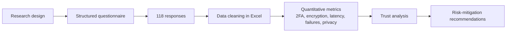

# Payment Gateway Security & Trust Analysis

**A quantitative study of consumer security perceptions, fraud-prevention frameworks, and trust in leading Indian payment gateways.**

This research examines how users perceive the security of digital payment platforms — specifically **Paytm**, **PayU**, and **CCAvenue** — and how factors such as two-factor authentication (2FA), encryption, transaction latency, authentication failures, and data-privacy concerns influence overall trust in the underlying payment infrastructure.

<p>


</p>

---

## Table of Contents

- [Overview](#overview)
- [Research Questions](#research-questions)
- [Scope](#scope)
- [Methodology](#methodology)
- [Key Findings](#key-findings)
- [Recommendations](#recommendations)
- [Repository Structure](#repository-structure)
- [Tools](#tools)
- [Data and Ethics](#data-and-ethics)
- [Limitations](#limitations)
- [Author](#author)

---

## Overview

Digital payments in India run on a small number of high-volume payment gateways. Trust in those gateways is shaped not only by their technical controls but also by how secure users *perceive* them to be. A gateway that is technically strong but communicates poorly can still lose consumer confidence.

This project is a **quantitative security and trust study** of consumer perceptions across three major Indian payment gateways. Structured security questionnaires were used to aggregate responses from **118 participants**, and the data was analyzed in **Microsoft Excel** to surface relationships between security features and user trust.

The study maps critical security gaps in the consumer experience and connects them to concrete risk-mitigation practices for financial platforms.

## Research Questions

1. How do consumers perceive the security of Paytm, PayU, and CCAvenue?
2. How aware are users of two-factor authentication and data-encryption practices?
3. How do transaction latency and authentication failures affect trust?
4. Which security features most strongly influence a user's willingness to trust a payment gateway?
5. What fraud-prevention and privacy controls should platforms prioritize?

## Scope

| Aspect | Details |
|---|---|
| Domain | Payment gateway security and consumer trust |
| Gateways studied | Paytm, PayU, CCAvenue |
| Population | Digital payment users in India |
| Sample size | 118 respondents |
| Data collection | Structured security questionnaire |
| Analysis | Quantitative analysis in Microsoft Excel |
| Focus areas | 2FA, encryption, latency, authentication failures, privacy, fraud prevention |

## Methodology

The study used a **cross-sectional quantitative design**. A structured questionnaire captured demographic information, gateway usage, security awareness, and trust perceptions. Responses were cleaned and aggregated in Excel, and quantitative metrics were calculated and visualized to compare gateways and identify relationships between security features and trust.

Full details are documented in [`docs/methodology.md`](docs/methodology.md). The survey instrument outline is available in [`docs/questionnaire.md`](docs/questionnaire.md), and the analysis themes are summarized in [`docs/findings.md`](docs/findings.md).



## Key Findings

The analysis identified several consistent themes:

- **Security perception drives gateway choice.** Perceived security and privacy strongly influence which gateway users trust.
- **2FA awareness is uneven.** Familiarity with and adoption of two-factor authentication varies across users, and stronger authentication is treated as a signal of trustworthiness.
- **Privacy and encryption matter.** Concerns about how payment data is encrypted and handled directly affect confidence in the platform.
- **Friction erodes trust.** Transaction latency and authentication failures reduce perceived reliability and, in turn, overall trust.
- **Trust is infrastructure-level.** Users extend their trust (or distrust) from individual transactions to the gateway and the wider payment infrastructure.

Detailed results and their interpretation are documented in [`docs/findings.md`](docs/findings.md).

## Recommendations

- Strengthen **two-factor and biometric authentication** for high-value transactions.
- Adopt **tokenization** to reduce exposure of sensitive card data.
- Deploy **AI-based fraud detection** for anomalous transaction patterns.
- Improve **transparency around encryption and data handling**.
- Align with **global security and compliance standards**.
- Reduce avoidable **authentication failures and latency** through better reliability engineering.

## Repository Structure

```text
payment-gateway-security-analysis/
├── README.md
├── LICENSE
├── .gitignore
├── docs/
│   ├── methodology.md      # research design, variables, analysis plan
│   ├── questionnaire.md    # survey instrument outline
│   └── findings.md         # themes, observations, recommendations
└── data/
    └── README.md           # dataset notes and privacy statement
```

## Tools

| Tool | Purpose |
|---|---|
| Microsoft Excel | Data cleaning, quantitative metrics, charts |
| Structured questionnaire | Primary data collection |
| Survey design | Instrument construction and validation |

## Data and Ethics

Participation was voluntary and responses were collected for academic research. Raw survey responses are **not published** in this repository to protect participant privacy. The repository documents the study design, instrument, and summarized findings only. Any data shared publicly would be aggregated and anonymized.

## Limitations

- The sample of 118 respondents is exploratory and not statistically representative of all Indian payment users.
- Self-reported perceptions may differ from measured technical security.
- The study compares three gateways and does not cover the full market.
- Findings describe associations rather than causal effects.

## Author

**Gokulakrishnan G** — Cybersecurity Analyst
[GitHub](https://github.com/Gokulgk6) · [LinkedIn](https://linkedin.com/in/gokulgk64)

## License

Released under the [MIT License](LICENSE).
